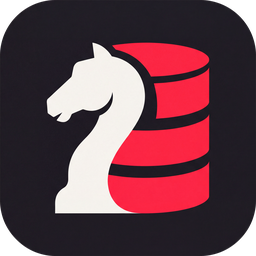
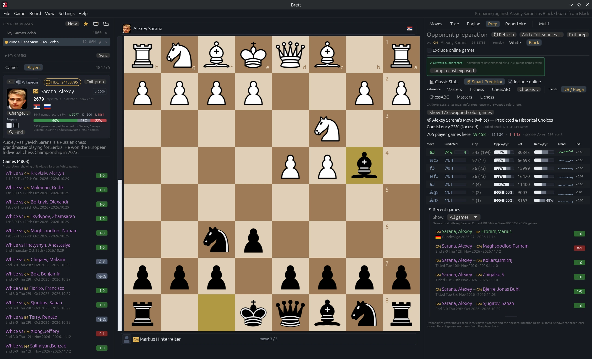
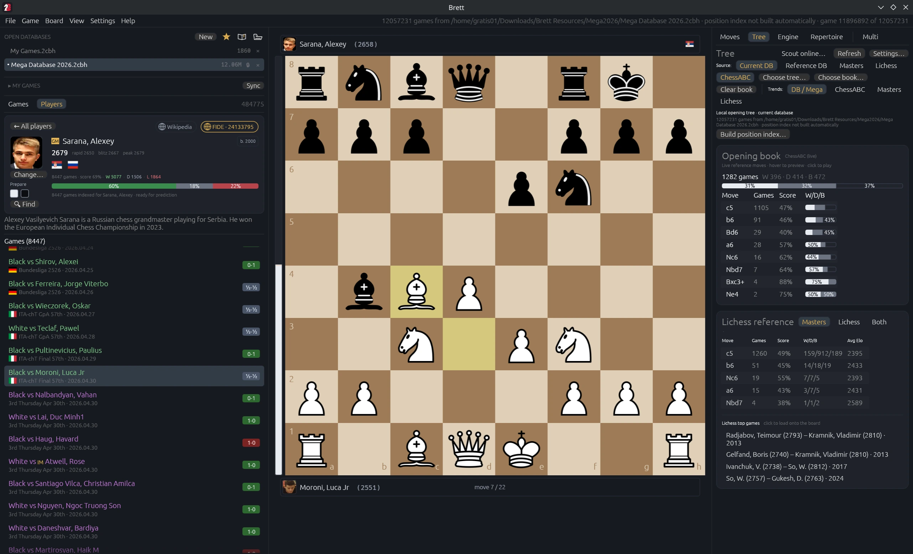
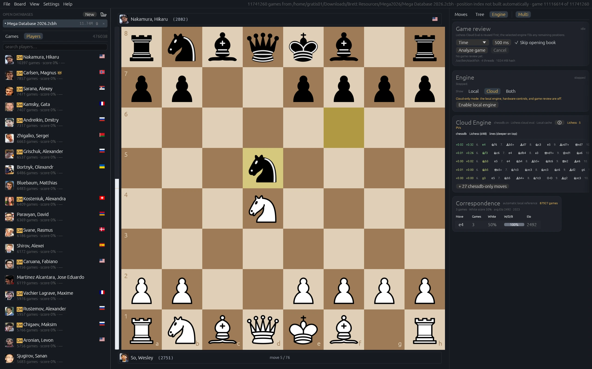
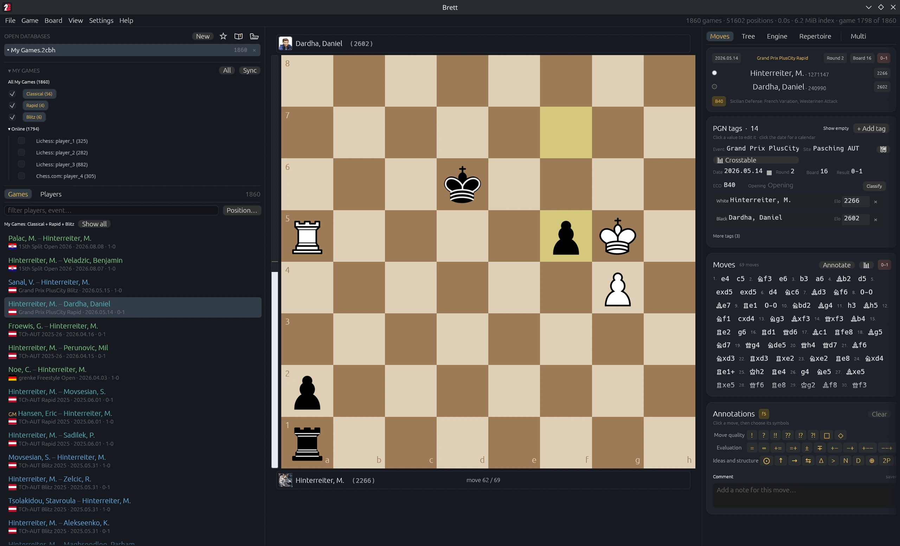

# Brett

<p align="center">
  
</p>

Brett is a free, open-source pure-Rust chess preparation and database suite.
It is built for opening preparation, multi-source opponent scouting,
database management, game review, and deep position analysis.

It supports reading and writing common database formats (`.2cbh`, `.cbh`,
`.si4`, `.pgn`) and opening books (`.bin`, `.ctg`, `.bkt`, `.abk`)
and handles multi-million-game archives such as Mega Database 2026
(~12M games; the initial load/indexing pass runs in the background so the
workspace stays responsive). Brett also integrates Lichess (opening explorer &
cloud evaluation), `chessdb.cn` (deep cloud analysis), ChessABC, and
Wikipedia/Wikidata metadata.

## Screenshots

### Opponent preparation & Smart predictor



The **Players** tab provides a direct preparation shortcut (White/Black squares right below the portrait) to launch scouting from any profile. Additional online accounts (**Lichess**, **Chess.com**, **ChessABC**) can be combined alongside local OTB databases and compiled into a single deduplicated player base cached on disk until its decay date by default—so restarting your device does not require recompiling the player base. In the right **Prep** tab, the **Off your public record** notice indicates that you have never reached this position over the board in public games (so an opponent cannot trace your public games to here), while the **Smart predictor** incorporates all available sources, recency trends, rating/speed priors, and Bayesian likelihoods to predict which move your opponent is most likely to play at the board.

### Player view, color-coded games & multi-provider Tree



The **Players** card shows biography metadata from Wikipedia/Wikidata, FIDE lookup, Rapid/Blitz/Peak ratings, lifetime score bars, and a game list **color-coded by game category** (Classical, Rapid, Blitz, Online). The **Tree** tab stacks every reference provider in one scrollable workspace: the local opening tree, the configured native `.bin`/`.ctg`/`.abk`/`.bkt` or live **ChessABC** opening book, and the **Lichess reference** explorer (**Masters**, **Lichess**, or **Both**) with clickable top games.

### Local & Cloud Engine Analysis, Correspondence Reference



The **Engine** tab combines **Game review** (reusing cached cloud evaluations up to target depth before invoking a local review engine), hot-swappable local UCI engine slots (`1`, `2`, `3`), the unified **Cloud Engine** table (`chessdb.cn` + Lichess Cloud Eval + local SQLite `analysis.db` cache), and the automatic local **Correspondence** reference database—shown alongside the filtered **My Games** tree on the left.

### Moves, PGN Fields & Annotations



A complete game-analysis view featuring editable **PGN tags** (event, site, date, round, board, ECO, opening, ratings, crosstable jump), the interactive **Moves** score sheet with collapsible variations and inline board diagrams, and a compact **Annotations** card (hidden by default to maximize notation space; toggle with **Annotate** or `A`) providing color-coded move-quality symbols, evaluation NAGs, structural motifs, and automatic comment saving.

## Licensing

* **Source Code:** Licensed under the [MIT License](LICENSE).
* **[Optional ICCF Reference Database](https://github.com/Lakis01/brett-correspondence_reference_base):** Not covered by the MIT License. Game data is provided courtesy of the ICCF and is subject to a strict **Non-Commercial / No-Resale License** (see [LICENSE-CRB.txt](https://github.com/Lakis01/brett-correspondence_reference_base/blob/main/LICENSE-CRB.txt) and `LICENSE-ICCF.txt` upon download).

## Quick start (Linux)

```sh
cargo run --release
```

You need Rust 1.97 or newer (the chess and PGN crates require it), a C
toolchain, the X11/Wayland development packages required by `eframe`, and
`zenity` or `kdialog` for file dialogs.
Stockfish is optional: Brett looks for `$BRETT_ENGINE`, then
`/usr/bin/stockfish`, and any UCI engine can be selected in the Engine tab.

The first launch opens an empty workspace with an **Open** prompt. Use
**File → Open database…** or drop a `.pgn`, `.si4`, `.si3`, `.cbh`, or `.2cbh`
onto the window. You can also pass a database path on the command line:
`cargo run --release -- /path/to/database.pgn`. Personal settings, caches, and
secrets live outside the repository; see [CONTRIBUTING.md](CONTRIBUTING.md) and
[Data safety](#data-safety).

## Platform support

Linux is the supported and tested platform. Brett has been built and visually
tested on **Arch Linux with KDE Plasma Wayland plus Xwayland**; the binary is
built with both the X11 and Wayland backends. Other mainstream Linux
distributions should work when the Rust/X11/Wayland build dependencies and
`zenity` or `kdialog` are installed, but they have not been validated here.
Package names and desktop integration vary by distribution.

**Windows and macOS are not currently supported or tested.** The file dialogs
shell out to `zenity`/`kdialog`, configuration uses XDG directories, and the
windowing/rendering stack has not been validated on either platform. A port
would need a native dialog backend, platform-specific config/cache paths, and a
fresh build-and-test pass; do not assume the current source compiles or runs
there.

## ICCF database notice

Brett can download and use an optional, curated
[ICCF Correspondence Reference Base](https://github.com/Lakis01/brett-correspondence_reference_base)
(~10 MB; games from 2021–present with both players rated 2350+), displayed as a
dedicated reference in the Engine tab beside Lichess Cloud Eval and chessdb.cn.
Because serious correspondence players back their choices with multi-day deep
engine analysis, moves heavily favoured there serve as a high-trust practical
indicator. The snapshot is refreshed sporadically — you may star that
repository to be reminded of updates. Permission was granted under ICCF's terms
for personal use only:

> **The ICCF database is provided for personal use only and may not be sold or
> re-sold to any third party.**

This notice applies to the ICCF database, the copy in `databases/iccf/`, and
any derived copy. It does not alter the MIT licence of Brett's source code.
Obtain newer snapshots from ICCF or the companion repository above under ICCF's
terms. See [ICCF_NOTICE.md](ICCF_NOTICE.md).

## What works

### Databases

- **PGN** files with a streaming header index: opening a 50,000-game file records
  headers and byte ranges, then builds a full tree only for the selected game.
- **SCID4 and SCID3** databases through an independent native reader
  (`src/scid.rs`). Brett reads the `.si4`/`.sn4`/`.sg4` triple directly; no SCID
  installation, conversion step, or SCID code is involved. Legacy SCID3
  (`.si3`/`.sn3`/`.sg3`) uses the same reader.
- **SCID4 export** through a native writer (`src/scid/writer.rs`).
  **File → Save database as… → SCID4** writes a new `.si4`/`.sn4`/`.sg4` triple
  with headers, comments, clocks, NAGs, variations, and custom starts. Existing
  triples are backed up and restored if the replacement fails; source databases
  are never overwritten.
- **Typst print export** for the current game. **File → Export current game as
  Typst…** writes A4, two-column source with a bold mainline, indented
  variations and comments, and real SVG board diagrams at user-chosen plies.
  Typst can compile a PDF locally when requested. See
  [docs/PRINT.md](docs/PRINT.md).
- **ChessBase 2CBH** databases through a native reader and writer
  (`src/twocbh/`). This is the current ChessBase container. Brett reads and
  writes moves, variations, headers, names, standard chess, Chess960, and
  nested variations. `.2cba` annotation items are not decoded yet, so
  comments, NAGs, clocks, and evaluations are not written.
- **Classic ChessBase CBH** databases through a native reader and writer
  (`src/cbh/`). Brett opens the `.cbh` header file and its `.cbg` moves,
  `.cba` annotations, and `.cbp`/`.cbt`/`.cbc`/`.cbs` names directly. This is
  the older multi-file format, not CBH2/2CBH. **File → Save database as… →
  Classic CBH** writes a fresh companion set.
- Lazy game loading for all three formats, a searchable game list, and a
  **Players** tab with career W/D/L, score, Elo, year range, and per-player
  game lists.
- Full game-tree import for all formats: recursive variations, comments, NAGs,
  `SetUp`/`FEN` positions, and analysis null moves.
- Drag and drop a `.pgn`, `.si4`, `.si3`, or `.cbh` onto the window, or use
  **File → Open database…**.
- Large archives such as the 11.1-million-game Mega Database are handled with
  interned headers, lazy session rows, and an O(1) row lookup. Above 500,000
  games the player directory is built in the background, so the game list stays
  usable while it runs. A full position index is built automatically only up to
  250,000 games; larger databases show a manual action, and full indexing is
  refused above 1,000,000 games until the external-sort indexer lands. Tree
  and opening-tree indexes have the same guard, and very large source files are
  rejected before they are opened just to be rejected.

### Tree workspace and position index

- A stable Zobrist key is computed for every mainline position. `(position,
  move)` statistics are aggregated into a sorted, memory-mapped file with
  games, W/D/L, Elo, and date ranges.
- The **Tree** tab stacks the local opening tree, the configured opening book, and the
  live Lichess explorer with top games in one workspace. The index is built in the
  background on first open and cached under `$XDG_CACHE_HOME/brett/index/`.
- A separate **opening-tree file** can be indexed for the Tree tab. Choose a
  PGN, SCID, or classic CBH database with **Choose…** or set its default in
  **Settings → Databases & sources**; the path is saved in `display.json` and
  loaded on the next launch. **Current DB** switches back to the open database.
  **Reference DB** switches the tree to the configured preparation reference.
- A source selector keeps one human-reference view in focus: the local database
  tree, Lichess Masters/All (with top games), live ChessABC, or a native opening
  book. Lichess games open as read-only previews. **Scout online…** opens the
  account-game panel for Lichess, Chess.com, or ChessABC.
- Native opening books: Polyglot `.bin`, ChessBase `.ctg` (with `.cto`/`.ctb`),
  Arena `.abk`, and Shredder `.bkt`. The Tree tab exposes each format through
  the same opening-book path and shows games, weight, score, W/D/B, and
  format-specific annotations.
- The index is built through a shared cache and edge format, with a streaming
  fast path for PGN and the generic library loader for SCID and classic CBH.
  See [docs/POSITION_INDEX.md](docs/POSITION_INDEX.md).

### Preparation

- Select a player on the **Players** tab (or start from **File → Prepare…**
  without a database open) and compile a deduplicated player book across local
  databases, ChessABC, and multiple Lichess / Chess.com accounts.
- Includes **Exclude online games** to strip Titled Tuesday and online
  fast-time-control experiments that would otherwise pollute an OTB repertoire,
  plus a reverse-colour warning when preparing a line your opponent frequently
  plays from the other side.
- For each opponent turn, **Smart Predictor** combines a background prior
  (ideally Mega Database, Lichess Masters, or another representative reference
  base) with the opponent's compiled games using a time-decayed Bayesian
  model weighting recency, time control, and OTB vs. online origin (parameters
  are under active calibration). It displays predicted move probabilities with
  visual likely-range bars, sample vs. recent game counts, emerging-trend
  sparklines, opponent vs. reference horizontal W/D/B bars, and merged engine
  evaluations (`chessdb.cn` + Lichess Cloud Eval + local cache). Experimental
  repertoire-style indicators (such as Booked-up / Freestyler and Kantian /
  Explorer) are also included in prototype form and under continued refinement.
- Probability mass is reserved for legal moves that do not appear in the data,
  so a move seen in 2/2 games is not shown as certain. The panel also shows a
  sample-size confidence label.
- At your turn the panel switches to the prepared player's moves so far in the
  current line, with each move's date, database score, and the likelihood and
  interval it had before it was played.
- The normal opening tree remains available in the separate **Tree** tab
  while the opponent-specific repertoire stays in **Preparation**.
- **Recent games** lists the newest games in the player book that reached the
  current position. The limit is configurable (default 10) and the list box
  height is vertically resizable. Clicking a game opens a read-only view;
  closing it returns to the same preparation position.
- The model is a time-decayed Dirichlet estimate with a background prior, a
  recent-window mixture, and an explicit residual for unobserved legal moves.
  Defaults: 18-month half-life, 24-month recent window, a sample-size-scaled
  background prior, and a 2-pseudo-game recent mixture.
- A separate reference PGN, SCID, classic CBH, or 2CBH database can supply the
  background prior.
  Brett indexes only the chosen rating window (default ±200 Elo, with a
  configurable rating offset) and caches it separately from the player index.
  If no reference is saved yet, `BRETT_REFERENCE` can supply a path. Without a
  usable reference, the panel visibly falls back to the current database prior
  and warns that it may be skewed.
- Player books are built from the player's mainline games in a background
  thread. Player identities ignore punctuation and word order, so
  “Fischer, Robert James” and “Robert James Fischer” share a book.
- **Settings → My player names** stores your aliases, highest priority first.
  The first alias is labelled **You** in the Players tab and replaces the
  literal `You` in preparation tag fields (the board strip still uses the
  alias). When a game contains one of the aliases, opening it flips the board
  to that side; the first matching name in list order wins, and the previous
  orientation is kept when nothing matches. Recent-game previews and **Exit
  prep** restore the side you were on before.
- Leaving preparation restores the game that was open before it started.
- See [docs/PREPARATION.md](docs/PREPARATION.md).

### Online imports

- **File → Import from Lichess…**, **Import from Chess.com…**, or **Import
  from ChessABC…** opens the single import dialog. It downloads public games
  for a username using public APIs. **Tree → Scout online…** is for
  browsing an opponent's recent games, not importing them.
- Lichess exports up to the requested number of games in one request.
  Chess.com has no bulk PGN endpoint, so Brett combines up to 36 recent monthly
  archives. ChessABC searches by player name or FIDE id.
- Imports are capped at 5,000 games and cached under
  `$XDG_CACHE_HOME/brett/online/`. Nothing is written next to a source database.

### Tree, cloud evaluation, and online accounts

- The **Cloud Engine** in the Engine tab combines chessdb.cn and the Lichess
  cloud evaluation. Its columns are **chessdb eval**, **Lichess eval (depth)**,
  and **line**; the move is part of the line, so there is no separate Move
  column. Every move in a Lichess line is hover-previewable and clickable.
- Rows are sorted by the average of the available chessdb/Lichess scores, best
  first for the side to move: White descending, Black ascending. Rows without
  an evaluation stay last. The best eight rows are always visible; the rest
  are under **More moves (N)**. Trailing chessdb-only rows are collapsed by
  default behind an expand control; Lichess and local-cache lines always stay
  visible. Chessdb-only rows say once that they have no Lichess evaluation and
  truncate after one ply.
- Colour is the delta to the best move for the side to move, not absolute White
  advantage: best green, worst red, missing evaluation grey, and mates dominate
  centipawns. chessdb.cn scores are normalised to White's point of view.
  Castling is matched across UCI encodings, and SAN uses `O-O`/`O-O-O`.
- **Tree** is for human practice: choose the current/configured database,
  Lichess Masters/All, ChessABC, or an opening book; compare move statistics,
  trends, and available games. Set the persistent reference base and tree/book
  defaults in **Settings → Databases & sources**. **Scout online…** browses
  player games; importing remains **File → Import**.
- **Preparation** is an independent opponent repertoire workspace, so starting
  a preparation no longer replaces the normal Tree view; its tab is only shown
  while the session is active.
- A configured local correspondence SCID database is used automatically in the
  **Engine** tab. Its inclusion and path are set in **Settings →
  Correspondence database**. The bundled snapshot is
  `databases/iccf/Correspondence_2350.si4` in a source checkout; a copy at
  `~/Downloads/Brett Resources/Correspondence Database/Correspondence_2350.si4`
  is also found, and `BRETT_CORRESPONDENCE` overrides both. When no reference
  is detected at startup, Brett offers a one-click download; **Not now** keeps
  asking on later launches, while **Don't remind me again** plus **Not now**
  stops the prompt. The first open builds a cached position index in the
  background, and later opens reuse the memory-mapped cache. Bundled games are
  capped at 70 plies. See
  [docs/CORRESPONDENCE_DATABASE.md](docs/CORRESPONDENCE_DATABASE.md).
- Requests run off the UI thread, are debounced while navigating, and are
  cached in memory per FEN. Hovering a candidate move overlays the resulting
  position without changing the selected game node; removing the pointer
  restores the original position.
- chessdb.cn and the Lichess cloud evaluation are public. Lichess
  opening-explorer requests in practice need a personal OAuth bearer token (no
  scopes are required); if Lichess rejects the request, Brett points you to
  **Settings → Lichess API**. To create a token, sign in at
  <https://lichess.org>, open
  <https://lichess.org/account/oauth/token/create>, give it a name such as
  `Brett`, leave every scope unchecked, and press **Create**. Copy the
  `lip_...` value immediately; Lichess shows it only once. Paste it into
  **Settings → Lichess API**, or set `BRETT_LICHESS_TOKEN` to keep it out of
  `references.json`. The environment variable takes precedence.

### Engine analysis

- The **Engine** tab works with any UCI engine: type its executable path or use
  **Browse…** to pick a downloaded engine. **Default Stockfish** resets the path
  to `$BRETT_ENGINE` or `/usr/bin/stockfish`.
- Choose the engine's **Threads** and **Hash / RAM** size (up to 32,768 MB),
  then press **Apply & restart**. The settings are sent as UCI `setoption`
  commands when the engine advertises those options, saved in
  `$XDG_CONFIG_HOME/brett/engine.json` (or
  `~/.config/brett/engine.json`), and reused at the next launch. Display and
  preparation/reference settings are stored in `display.json` and
  `preparation.json` beside it.
- Choose depth or time, 1–5 MultiPV lines, and auto-analysis on position change.
  The **Auto analyze** checkbox is saved in `display.json` and restored at the
  next launch, so it keeps the last state until you change it.
  Hovering a PV move previews its position; clicking a move plays the line up
  to that point. Results from an older position are discarded. PVs are shown
  with real move numbers (`25... e5 26. Nf3 Nc6`) and labelled **Engine PV**,
  **Lichess PV**, or **Lichess line** so analysis-line numbering never looks
  like a chess move number.
- The **Show** selector switches the Engine tab between **Local**, **Cloud**,
  and **Both**. **Both** keeps local UCI analysis and the **Cloud Engine**
  table visible together. **Cloud** is a true Cloud-only mode: the local
  engine is stopped and local engine/hardware settings and local analysis are
  hidden, not merely replaced by an eval. **Enable local engine** returns to
  Both.
- Local engine runs and Deep Cloud evaluations are cached automatically in a
  compact local SQLite database (`analysis.db`, typically staying within a few
  megabytes even across heavy daily prep). Lichess Cloud Eval itself is
  read-only from Lichess's API side—compute contributions go through Fishnet to
  prevent unverified or injected evaluations—so Brett keeps your personal
  analysis history locally and lets you export/import cache snapshots across
  machines.
- The worker performs the UCI handshake off the UI thread, waits for `readyok`,
  kills the engine cleanly on exit, and reports protocol or process errors in
  the panel.

### Game review

- **Game review** sits at the top of the **Engine** tab and starts a dedicated
  local process using the selected engine, thread count, and hash size, by depth
  or time per move, with a progress bar and cancel button. It remains available
  when local auto-analysis is off and also works while Engine is in Cloud-only
  mode. Review checks Lichess Cloud Eval first up to the configured depth (or a
  sensible breakoff depth in time mode) and finishes any remaining positions
  locally.
- Each move is graded from the centipawn change between the engine evaluation
  before and after the move: best move, excellent (≤20 cp lost), good
  (≤50), inaccuracy (≤100), mistake (≤250), or blunder (>250). Forced moves
  are marked without a centipawn penalty, and mate scores are compressed so
  they dominate normal evaluations without breaking the graph.
- The panel shows an estimated accuracy percentage, a white-perspective
  evaluation graph, and a clickable move list. Clicking a row jumps to that
  move. **Write NAGs to mainline** copies the grades into the in-memory tree as
  `!!`/`!`/`?!`/`?`/`??` annotations.
- Accuracy is a documented heuristic based on centipawn loss, not an official
  rating.

### Board and move list

- 2D board with the cburnett piece set, coordinates, legal-move hints, click or
  drag-and-drop to play moves, and branching into variations. Castling accepts
  a king dragged to its destination square (`g1`/`c1`/`g8`/`c8`) as well as to
  the rook.
- Player names, optional title badges (`WhiteTitle`/`BlackTitle`), and ratings
  are shown above and below the board on their playing side. Wikipedia/Wikidata
  title history can replace a tag with the title actually held on the game's
  date when an award year is known. When an optional
  local Scid photo pack is available, a portrait appears beside each player;
  **Settings → Show player photos** hides or shows it, and **Settings → Photo
  size** selects Small (38 px), Medium (54 px), or Large (72 px). Clicking an
  existing portrait opens a standalone 240×300 view; clicking an empty
  silhouette opens an image picker and stores the chosen image as a 400 px
  lossless WebP under `$XDG_CONFIG_HOME/brett/portraits/`, overriding the photo
  pack for that player. The profile's **Change…** and **Remove** actions replace
  or clear a custom portrait. The Players tab shows a fixed 34 px thumbnail in the
  list and the selected size in the player header. No photo data is
  redistributed with Brett — see [docs/PHOTOS.md](docs/PHOTOS.md).
  Federation flags appear on the board strips, Players list, and profile
  (hover for the country and available federation years); game lists omit
  player-nationality flags and show only a conclusive venue flag.
  **Settings → Player ratings** chooses the Elo/DWZ/USCF priority and can show
  every available rating instead of only the preferred one.
- Recognized world champions carry a gold crown (👑) in the board strips, the
  Players list, and the selected-player header. Hovering the crown explains the
  title line, reign, and one factual note (for example, Magnus Carlsen was
  World Champion 2013–2023). **Settings → Champion lineage** selects
  **FIDE/inclusive** (default; includes the four FIDE knockout champions from
  1999–2006) or **Classical/PCA** (the uninterrupted line from Steinitz). See
  [docs/CHAMPIONS.md](docs/CHAMPIONS.md).
- Start, Previous, Next, and End buttons sit beside the board and are hidden by
  default; **Settings → Show navigation buttons** reveals them. The keyboard
  shortcuts work either way.
- The FEN field lives in the bottom bar beside the move counter; clicking it
  copies the FEN. The move counter counts full moves, not plies.
- The Moves header keeps one metadata line: compact `R`/`B` chips, the event
  truncated rather than wrapped or squeezed, and the result right-aligned.
  ECO and Opening are always available as one compact editable row. The `🎯`
  button classifies only the current game from its mainline. If the game
  already has ECO/Opening values, Brett shows the current and proposed values
  and asks before replacing them; untagged games are filled without a prompt.
- Coloured squares and arrows are first-class board drawings: right-click or
  Shift-click to mark a square, drag with those buttons to draw an arrow, and
  click without a modifier to clear the current position's shapes. Ctrl/Shift
  selects red, Alt/Command blue, and one key from each group yellow, matching
  Lichess. Drawings round-trip through PGN `%csl`/`%cal`, SCID `%draw` input,
  and classic CBH `.cba` annotations.
- The right-side PGN panel has a styled game header, an editable tag table,
  result badge, unified `21px` move/NAG tokens, inline variation delimiters, and
  single-line clickable comment chips. **Settings → Show PGN tags** hides the whole
  editable tag card when you want more room for the move list, while **Show annotations**
  is hidden by default and toggles via **Annotate** (or `A`). WhiteElo and
  BlackElo are separate editable fields to the right of the White/Black name
  boxes; Elo is not appended to the name and there is no derived rating chip.
  Fields that are absent or empty are hidden by default; **Show empty** reveals
  the usual metadata fields so a new game can be filled in without adding each
  tag by hand. Board is hidden when empty unless **Show empty** is on or it was
  added with **+ Add tag → Board**, and it is written as `round.board` inside
  the Round tag. The Date field can be typed directly or opened as a calendar
  anchored to the field.
- **More tags (N)** / **Fewer tags** replaces the old arrow expanders. The
  additional-tag list is capped in height and scrolls, so a game with many
  tags does not push the move list off the panel. Tag names are fixed; values
  can be edited, tags can be removed, and common missing tags can be added.
- The whole Moves tab scrolls vertically, while the move list keeps its own
  bounded scroll area. Long annotations, comments, and tag cards therefore stay
  reachable instead of running past the bottom of the window.
- PGN clock comments (`[%clk ...]`) are parsed separately from human comments
  and shown by default. **Settings → Display → Show PGN clocks in the board
  strips** controls the remaining time at the right of each board strip.
- Hovering a move in the open game's move list previews the resulting
  position. This is controlled by **Settings → Preview moves on hover** and is
  off by default; tree, engine, and read-only preview hovers are always
  available.
- Chess figurines are used for piece moves. The embedded DejaVu Sans fallback
  provides the chess and annotation glyphs.
- Clicking an annotation opens the inline annotation editor. Right-clicking a
  move or annotation opens the grouped NAG palette, including `!?`, `+=`, `=+`,
  `∞`, `□`, and the other standard symbols. Comments are editable in the same
  panel.
- Keyboard: `←`/`→` previous/next move, `↑`/`↓` previous/next game,
  `Home`/`End` or `PageUp`/`PageDown` start/end, `F` flip board, `T` or `C`
  Tree, `Shift+P` Preparation, `M` Moves, `E` Engine, `R` Game review in Engine, `P` Players,
  `A` annotate the selected move, `O` online opponent panel, `D` date calendar,
  `Escape` closes the calendar, annotation
  editor, or board selection.
- At a position with more than one continuation, `→` opens a branch popup
  instead of silently following the mainline. The mainline is selected first
  and variations follow by most recent use in this session. Use `↑`/`↓` to
  choose, `Enter` or `→` to play, `1`–`9` to pick directly, and `Esc`/`←` to
  cancel. The popup also appears inside variations.

### Settings

- **Player ratings** — choose Elo, DWZ, or USCF as the priority and optionally
  show all available ratings.
- **My player names & unified My Games identities** — one alias per line,
  highest priority first. The first alias is labelled **You** in the Players
  tab, replaces the literal `You` in preparation tag fields, and automatically
  merges linked Lichess, Chess.com, and ChessABC online usernames under that
  single **You** player profile (sharing your custom portrait across all
  aliases). Matching games automatically orient the board to your side on open
  and during hover preview.
- **Display** — **Show player photos** (enabled when a local pack is present),
  **Photo size** (Small/Medium/Large), **Champion lineage** (FIDE/inclusive by
  default, or Classical/PCA), **Show navigation buttons** (off by default),
  **Show PGN tags** (on by default), **Show annotations** (off by default; toggle
  anytime via **Annotate** or `A`), **Game category colors** (Classical, Rapid,
  Blitz, Online), and **Preview moves on hover** (off by default). Custom player
  portraits live in `$XDG_CONFIG_HOME/brett/portraits/` and custom position
  presets live in `$XDG_CONFIG_HOME/brett/custom_structures.json`, so both
  persist across builds and updates. Photo data is not redistributed with Brett;
  see [docs/PHOTOS.md](docs/PHOTOS.md) and
  [docs/CHAMPIONS.md](docs/CHAMPIONS.md).
- **Player profiles & historical federations** — load Wikipedia/Wikidata summaries
  on demand, or click **Enrich…** in the **Players** tab (or **Settings → Enrich
  player metadata…**) to batch-enrich top players, 10+/3+ game players, or an
  entire database with progress and cancellation. Enrichment handles
  generational suffixes (`Jr`/`Sr`), historical spelling variants (`William` /
  `Wilhelm`), and multi-flag historical federations from 1800 to the present
  (`AUE`, `AUH`, `BOH`, `DEI`, `PRU`, `RUE`, `TCH`, `URS`, `YUG`, `GDR`, `FRG`,
  `SCG`, etc.) alongside Wikidata `P2962` title timelines.
- **Correspondence database** — include or exclude the local correspondence
  database in the Engine tab, choose its file, or restore the conventional
  location. The database appears as a dedicated human-game reference section in
  Engine, separate from engine evaluations.
- **Databases & sources** — choose the persistent preparation reference base,
  opening-tree database, and optional native opening book. A blank tree source
  uses the current database; a disabled/blank preparation reference uses the
  current database as its visible fallback.
- **Lichess API** — create-token link, token field, and the
  `BRETT_LICHESS_TOKEN` override. The token is stored in `references.json`
  only if you save it here.

### Benchmarks

On the local 49,780-game `Frese Sammlung` SCID database (8.0 MiB triple, 3.8 M
mainline moves), in the development profile:

- header index: **0.28 s**, zero decode errors;
- position index: **16.5 s** for 2.94 M positions / 3.01 M move records, a
  **137.6 MiB** memory-mapped file;
- start position: 48,619 games with a move available.

The native reader was also exercised against every `.si4` database in the local
reference corpus with zero errors. `cargo run --example scid_report -- file.si4`
decodes every game and reports failures; use it after format changes.

## Development

New contributors should read [CONTRIBUTING.md](CONTRIBUTING.md) first. It
covers the Linux prerequisites, build/test commands, secret hygiene, read-only
source rules, and the platform-support caveat.

```sh
cargo test --all-targets
cargo clippy --all-targets -- -D warnings
cargo fmt --all

cargo run --release -- path/to/file.pgn
cargo run --release -- path/to/database.si4

cargo run --example report -- file.pgn           # PGN import statistics
cargo run --example index_report -- file.pgn     # header index + lazy-load timing
cargo run --example position_report -- file.pgn  # opening-tree index benchmark
cargo run --example predictor_eval -- file.pgn "Player Name" 20
                                                # chronological held-out metrics
cargo run --example scid_report -- file.si4      # decode every SCID game
scripts/scid-to-pgn.sh "/path/to/db" /tmp/opencode/out.pgn
```

`scripts/scid-to-pgn.sh` copies the SCID triple to `/tmp/opencode` first; it
never writes to the source database.

## Code map

| Path | Purpose |
| --- | --- |
| `src/library.rs` | `GameLibrary` interface, streaming PGN index, shared source metadata |
| `src/scid.rs` | Native SCID3/SCID4 reader and `ScidLibrary` |
| `src/scid/writer.rs` | Native SCID4 writer, namebase/index construction, rollback-safe export |
| `src/cbh/` | Native classic ChessBase CBH reader and writer |
| `src/twocbh/` | Native ChessBase 2CBH reader, `.2lgd` accelerator, and writer |
| `src/position.rs` | Position index, opening-tree statistics, shared library builder |
| `src/players.rs` | Player directory, alias grouping, per-player books, Bayesian prediction |
| `src/evaluation.rs` | Held-out log loss, Brier score, top-k accuracy, calibration |
| `src/online.rs` | Public Lichess, Chess.com, and ChessABC imports |
| `src/my_games.rs` | Unified My Games configuration, categorized sub-shelves, online startup sync |
| `src/account_finder.rs` | Repertoire-fingerprint matching to locate online accounts in clubs/teams |
| `src/twic.rs` & `src/league_import.rs` | Automated TWIC & regional league/broadcast tournament importers |
| `src/cloud.rs` | chessdb.cn, Lichess opening explorer, and Lichess cloud eval |
| `src/live.rs` | Live game broadcast & online follower streams |
| `src/domain.rs` | Game tree, PGN parsing, move lines, figurines, NAG palette, clocks |
| `src/engine.rs` | Asynchronous UCI process, multi-slot orchestration, parser, worker threads |
| `src/analysis_cache.rs` | Persistent SQLite `analysis.db` cache across engine families |
| `src/book.rs` & `src/book/` | Native Polyglot (`.bin`), ChessBase (`.ctg`), Arena (`.abk`), Shredder (`.bkt`) readers |
| `src/cbv.rs` | ChessBase `.cbv` container extraction into a classic CBH library |
| `src/search.rs` & `src/structure_plans.rs` | Clean-room 64-square bitboard position search, 51 middlegame structure presets, custom overrides, and animated strategic plans |
| `src/repertoire.rs` | Opening Repertoire Builder & SM-2+ spaced-repetition trainer |
| `src/recent.rs` | In-memory recent-game trees and move-trend statistics |
| `src/wiki.rs`, `src/country.rs`, `src/flags.rs`, `src/titles.rs`, `src/fide.rs` | Wikipedia/Wikidata enrichment, historical 1800–present federations & 4:3 flags, title timelines, live FIDE ratings |
| `src/photos.rs` | Optional BPF1 player-photo pack reader, alias/custom WebP portrait resolver |
| `src/champions.rs` | World-champion table and classical/FIDE lineage matching for the crown |
| `src/session.rs` | Editable ordered session, database views, reorder/merge, PGN export |
| `src/settings.rs` | Persistent engine, cloud, reference-database, display, and preparation settings |
| `src/review.rs` | Sequential game review, clock-pacing summaries, move grading, eval chart data |
| `src/print/` | Backend-neutral print document, SVG board diagrams, Typst renderer and bundle writer |
| `src/app.rs` | egui application, tabs, preparation flow, `Operate`-mode UI cards |
| `src/ui/fonts.rs` | Embedded DejaVu Sans fallback for chess symbols |
| `docs/` | Data safety, position-index format, preparation model, SCID/CBH readers, provenance audit, photo provenance, backlog |

## Roadmap

- **M1 — database index (done).** Header-only first pass, lazy per-game trees,
  and byte-offset loading.
- **M2a — position index and opening tree (done).** Zobrist keys, on-disk
  sorted/mmap store, W/D/L, Elo and date aggregates, clickable tree.
- **Native SCID (done).** SCID4/SCID3 reader, namebase, tags, variations,
  comments, NAGs, custom FEN, null moves, position indexing, and a native
  SCID4 writer with rollback-safe export.
- **Preparation stage (done).** Player directory, player books, prediction,
  Prepare as White/Black, online imports, annotation editing, PGN panel.
- **UCI engine (done).** Any UCI executable, persistent Threads/Hash settings,
  MultiPV analysis, asynchronous worker, clickable principal variations,
  Stockfish default.
- **Clock display (done).** PGN `[%clk]` parsing, hidden by default, shown
  after each move, in the game header, and beside the players at the board.
- **Castling by dragging the king (done).** King-to-destination and
  king-to-rook gestures both work.
- **PGN metadata (done).** Editable common tags, fixed tag names, delete/add,
  Elo/DWZ ratings, and player strips above and below the board.
- **Game Review (done).** Per-position Stockfish pass with progress/cancel,
  centipawn-loss grades, forced-move handling, accuracy summary, evaluation
  graph, clickable move list, and optional NAG write-back.
- **Moves-panel interaction polish (done).** PGN fields hide when absent or
  empty, **Show empty** reveals the standard metadata, Board is written as
  `round.board`, branches open a keyboard chooser, engine/cloud lines use real
  move numbers, and open-game move hover is an opt-in setting.
- **Preparation view v2 (done).** Normal tree statistics at every turn,
  opponent move history, a configurable clickable recent-games window, and a
  read-only game preview that preserves preparation state.
- **Predictor v2 and reference distribution (done).** Posterior uncertainty,
  unobserved-move residual mass, a separately cached rating-matched reference
  index, visible fallback, held-out metrics, and calibration output.
- **Classic CBH support (done).** Native read-only support for the older
  multi-file format, including modes 0/4/5/10, variations, comments, NAGs,
  drawing tokens, custom starts, and Chess960. See
  [docs/CBH.md](docs/CBH.md) and the component audit in
  [docs/PROVENANCE.md](docs/PROVENANCE.md).
- **Tree workspace (done).** The **Tree** tab stacks the local database tree,
  Lichess Masters/All, ChessABC, native opening books, and Lichess top games.
  The online opponent scout remains available there; source defaults live in
  Settings. The **Cloud Engine** in Engine combines chessdb.cn, Lichess, and the
  local analysis cache. The **Preparation** tab appears only during an active
  preparation session, and **Game review** lives at the top of Engine.
- **UI and release polish (done).** Cloud Engine columns, average-eval sorting,
  top-eight/More moves, Cloud-only guards, multi-section right panel, My player
  names and auto-orientation, persistent FEN strip and full-move counter,
  inline WhiteElo/BlackElo fields, compact PGN tags, title badges, multiple
  ratings, ICCF notice, and secret-safe contribution rules.
- **Permissive dependency path (done).** Replaced the GPL-licensed `shakmaty`
  and `pgn-reader` crates with MIT-licensed `cozy-chess` 0.3.4 behind a
  Brett-owned chess facade, a Brett-owned streaming PGN parser, and a
  Brett-owned Polyglot Zobrist hash; see
  [THIRD_PARTY_NOTICES.md](THIRD_PARTY_NOTICES.md) and
  [docs/GPL_OPTIONS.md](docs/GPL_OPTIONS.md).
- **M2b — Mega-scale ingest.** External sorting, an on-disk header table, and
  incremental updates for multi-million-game databases.
- **Database editing and export (done).** Drag rows to reorder the current
  list, drag games between internal database views, and drag a database onto
  another to merge it. **File → Save database** writes the session in its
  current format; **Save database as…** chooses PGN, SCID4, classic CBH, or
  2CBH. A new database asks for a format, and 2CBH is writable: the first
  writer preserves moves, variations, and metadata but not comments, NAGs,
  clocks, or evaluations. Saves preserve headers, comments, clocks, NAGs, and
  variations for the other formats; exports estimated at 100 MB or more ask
  for confirmation first. The last database folder is remembered for Open and
  Save As, and closing a modified database asks whether to save, discard, or
  cancel.
- **Opening-tree files and reference sources (done).** A separate PGN, SCID,
  or classic CBH database can be indexed in **Tree** and saved as the
  default. Settings configure the preparation reference base; online account
  scouting remains a game-focused action. Native Polyglot `.bin`, ChessBase
  `.ctg`, Arena `.abk`, and Shredder `.bkt` books are supported.

- **Unified My Games database & startup online sync (done).** Configure a personal My Games database in any writable format (`.2cbh` by default, `.si4`, `.cbh`, `.pgn`) with expandable subsections (`Classical`, `Rapid`, `Blitz`, and `Online → Lichess / Chess.com` across multiple accounts), multi-section checkbox filtering, direct drag-and-drop / file merging into any subsection, and automatic startup online sync.
- **Automatic TWIC downloader (done).** Fetch weekly issues (`https://theweekinchess.com/twic`) by explicit list/ranges (e.g. `645, 653, 664-672`), presets (`Latest`, `Since last fetched`, `Last 4`, `Last 12`), or date intervals, as well as the searchable/filterable tournament archive (`https://theweekinchess.com/a-year-of-pgn-game-files`), merging directly into the active DB, My Games, or a new database.
- **Partial & exact bitboard position search & Structure Plans (preliminary — contributions welcome!).** Clean-room MIT 64-square pattern matcher (**Game → Position search…**) with piece/empty/`Any` brushes, Boolean `OR`/`AND`/`NONE` conjunctions, 51 structural presets (including **Hanging Pawns** & **IQP** differentiations by opponent `e`/`c`-pawn and kingside fianchetto, **Maróczy**, **Najdorf**, **Panov**, **Semi-Slav**, **Grünfeld**, **Botvinnik**, **Stonewall**, **Carlsbad**, **Hedgehog**, **Badewanne**), persistent custom overrides (`custom_structures.json`), color-flipped mirroring, 64 original animated strategic plans across all 9 structure families, resumable 1,000-hit interval / Search-All scanning, **Structure Elo / Opponent Elo** sorting, an interactive searchable **ECO range & opening-description browser**, Rayon scanning, hover preview at the matched ply, and direct game navigation.

  > [!NOTE]
  > **Position search filters and strategic plan illustrations are preliminary and still need work.** If you hand-tune any structure presets in Brett's Board Pattern editor (including `OR` / `AND` / `NONE` conjunctions saved in `$XDG_CONFIG_HOME/brett/custom_structures.json`), or want to refine/expand strategic plan illustrations, contributions via GitHub Issues or Pull Requests are very welcome — see [CONTRIBUTING.md](CONTRIBUTING.md#contributing-position-search-filters--structure-presets).
- **Repertoire Builder & SM-2+ Train mode (done).** Clean-room MIT **Repertoire** workspace (`Build` with Zobrist transposition grouping and **"Jump to biggest gap"** against your Reference/Tree DB, plus `Train (SRS)` interactive move recall drills rated `1 Again`–`4 Easy`).
- **Wikipedia, historical federations (1800–present) & Players identity grouping (done).** Resolves `Jr`/`Sr` suffixes and spelling variants (`Steinitz, William`), displays multi-era flags (`AUE`, `AUH`, `BOH`, `DEI`, `PRU`, `RUE`, `TCH`, `URS`, `YUG`, `GDR`, `FRG`, `SCG`), groups linked online accounts under **You** with shared custom portraits, and autoflips the board on game hover.
- **Moves, Annotations & Clock analytics (done).** Clean `Operate`-mode unified move/NAG pills, collapsible variations, toggleable **Annotations** panel (hidden by default via **Annotate** / `A`), Game Review with Lichess Cloud Eval reuse and NAG write-back, and per-player clock pacing analytics in player profiles.
- **Planned / upcoming.**
  - Mega-scale (1M+ games) external-sort position indexer and continued predictor calibration.

## Data safety

Source PGN, SCID, classic CBH, and 2CBH collections are **read-only**. Brett
opens them for reading only, and exports to any of these formats are writable.
Derived indexes and imported games go to `$XDG_CACHE_HOME/brett/`, and
personal preferences go to `$XDG_CONFIG_HOME/brett/`; nothing is written next
to a source database. PGN exports default to the home directory, refuse to
overwrite the open source file, and refuse targets inside the protected source
roots. The conventional
`$HOME/Chess Databases` and `$HOME/Downloads/CBH` directories are protected
automatically when they exist; add more with `BRETT_READ_ONLY_ROOTS`.

The Lichess reference token, if configured, lives in `references.json` in the
config directory, or in `BRETT_LICHESS_TOKEN`. Do not commit either. The ICCF
database is redistributed under its non-sale notice; see
[ICCF_NOTICE.md](ICCF_NOTICE.md).
See [docs/DATA_SAFETY.md](docs/DATA_SAFETY.md) and
[CONTRIBUTING.md](CONTRIBUTING.md#secrets-and-personal-settings).

## Third-party assets and references

The piece images in `assets/pieces/` are the **cburnett** set by
Colin M. L. Burnett, licensed **CC BY-SA 3.0**, converted from the SVG sources
in the [Lichess repository](https://github.com/lichess-org/lila/tree/master/public/piece/cburnett).
See `assets/pieces/README.md`.

The embedded fallback font is **DejaVu Sans**, under the Bitstream Vera /
DejaVu licence. See `assets/fonts/README.md`.

The SCID and classic CBH readers are independent implementations written from
published on-disk formats. The SCID source tree and the AGPL ChessBase bridge
were used as format references only; no code from either is linked or copied.
See [THIRD_PARTY_NOTICES.md](THIRD_PARTY_NOTICES.md).

The optional player-photo pack can be generated from Scid's
`Player_photos.zip` (`scid/PlayerData/Player_photos.zip`), which remains
strictly uncommitted due to copyright and attribution concerns—even when
free-to-use portraits exist (for example on Wikipedia), scraping batches of
images without ironclad, verified attribution carries strict legal liability
in jurisdictions with aggressive copyright enforcement. See
[docs/PHOTOS.md](docs/PHOTOS.md) and
[THIRD_PARTY_NOTICES.md](THIRD_PARTY_NOTICES.md#scid-player-photos-optional-not-distributed).

## Licence

Brett's original application code is **MIT** — see [LICENSE](LICENSE). The
piece artwork remains CC BY-SA 3.0, and the font remains under its own licence.

Brett links only MIT/permissive runtime dependencies, with `cozy-chess` 0.3.4
for chess rules, a Brett-owned streaming PGN parser, and a Brett-owned Polyglot
Zobrist hash. See [THIRD_PARTY_NOTICES.md](THIRD_PARTY_NOTICES.md) and
[docs/GPL_OPTIONS.md](docs/GPL_OPTIONS.md).
