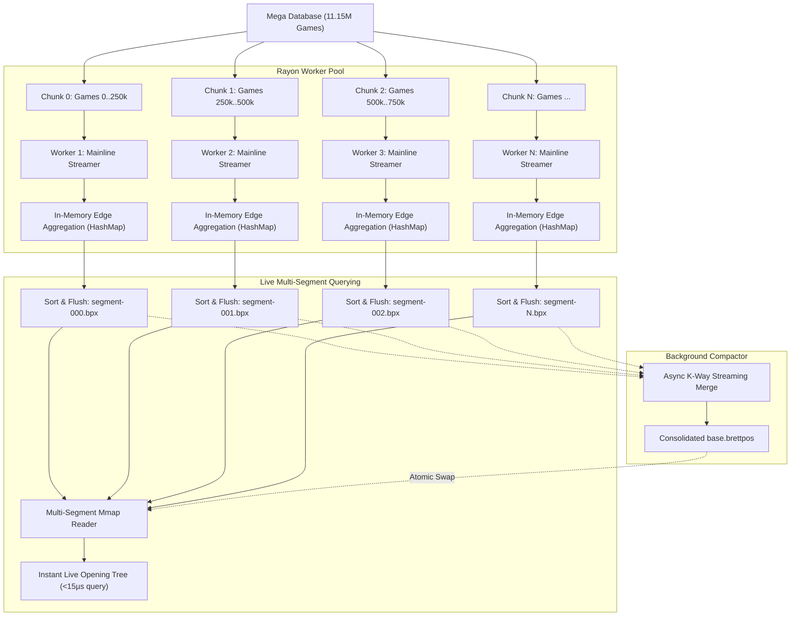

# M2b: High-Performance Multi-Million-Game Indexing & Tiered LSM Position Index

Date: 2026-11-03
Status: design for approval

## Intent

To provide fluid, instant exploration of multi-million-game archives (such as Mega Database 2025 with 11.15M+ games and ~800M plies) comparable or superior to commercial desktop suites like ChessBase.

Currently, indexing databases above 1,000,000 games is artificially blocked in Brett (`FULL_INDEX_MAX_GAMES = 1_000_000`), and indexing was previously throttled to ~2,000 games/sec because the builder eagerly deserialized full `domain::Game` ASTs (allocating move nodes, comment strings, NAG vectors, and variation trees) and processed games sequentially on a single thread.

This design implements:
1. **Zero-allocation mainline move streaming** for `.cbh`, `.2cbh`, and PGN containers.
2. **Parallel chunked Rayon ingestion** with **in-memory edge aggregation** prior to disk flush.
3. **Tiered LSM-tree index architecture** with immediate multi-segment querying (`mmap`), live progressive opening tree availability, and zero-rebuild incremental game appends.
4. **Asynchronous background compaction** ($K$-way external merge) that merges segments into a unified `.brettpos` index without blocking queries or the UI.
5. **Removal of artificial game caps** in `src/app.rs` with real-time throughput metrics (games/sec, segment flushes, phase progress).

---

## Architectural Principles & Hardware Optimization

An 11.15M-game database contains roughly 800M half-moves. Handling this scale with bounded memory (< 512 MiB RSS) requires matching each phase to hardware capabilities:

| Phase | Hardware Bottleneck | Architectural Solution |
|---|---|---|
| **1. Ingestion** | CPU & Memory Allocation | Zero-allocation byte-level mainline decoding on a stack-allocated board state (`cozy_chess::Board`). No ASTs, variations, comments, or NAGs are allocated. |
| **2. Aggregation & Sorting** | Memory & I/O Bandwidth | In-memory aggregation within each chunk (shrinking records by 70–80% due to early move convergence) before flushing sorted segments to disk. |
| **3. Querying & Appending** | Random Access & Latency | Multi-segment `mmap` binary searching ($K \times \mathcal{O}(\log N) \approx 15\,\mu\text{s}$). Live queries after segment 1 completes; new games append as delta segments without rewrites. |
| **4. Compaction** | Sequential I/O | Asynchronous $K$-way streaming merge with a min-heap, atomically replacing segments with a single consolidated `.brettpos` file. |

---

## Detailed Components

### 1. Zero-Allocation Mainline Streamers

Instead of loading games via `library.load(index)` which builds full `domain::Game` objects, each library format exposes a dedicated mainline iterator:

```rust
pub trait FastMainlineSource: Send + Sync {
    /// Stream mainline moves up to `max_plies` for game at `index`.
    /// Calls `consumer(pos_key, move_code)` for each move.
    fn stream_mainline<F>(&self, index: usize, max_plies: u32, consumer: &mut F) -> Result<()>
    where
        F: FnMut(u64, u32);
}
```

- **Classic CBH (`src/cbh/fast_index.rs`):**
  - Reads packed move bytes from `.cbg` (or `.cbj` for large offsets) using the existing `PieceLists` state machine.
  - Follows only the mainline line (`stack.is_empty()`); halts immediately when the mainline ends (`ended = true`) or when `plies >= max_plies`.
  - Maintains a 64-byte stack-allocated board state (`Chess`).
  - Generates Zobrist key directly from `board.hash()` and move code from `encode_move(mv)`.
  - Zero heap allocations per move and zero AST allocations.

- **2CBH (`src/twocbh/fast_index.rs`):**
  - Directly iterates 16-bit move tokens from `.2cbg` memory map.
  - Follows the initial line until `END_LINE` (token `0xFFFF`) or `max_plies`.
  - Decodes move tokens directly using `Square` bitfields, executes move on stack board, and emits key/move pairs.

- **PGN (`src/pgn/fast_index.rs`):**
  - Uses the existing streaming visitor `IndexVisitor`, skipping variations and comments.

- **Ply Clamping:**
  - Indexing defaults to capping at ply 60–80 (configurable in `BuildOptions`).
  - Like ChessBase `.ctg` trees, capping prevents deep endgame transpositions from polluting the unique opening node namespace while capturing all relevant opening and middlegame theory.

### 2. Parallel Chunking & In-Memory Pre-Aggregation



- Games are partitioned into chunks of 250,000 games.
- Rayon processes chunks in parallel. Each worker maintains an in-memory `HashMap<(u64, u32), EdgeRecord>`.
- In-chunk aggregation: Multiple games reaching the same position with the same move immediately increment `games`, `white`, `draw`, `black`, `elo_sum`, `elo_count`, and date bounds in the local hash map.
- When the chunk completes, edges are collected into a vector, sorted by `(key, move_code)` with `sort_unstable_by`, and written to a standalone segment file (`.tmp_segment_XXX.bpx`).

### 3. Tiered LSM-Tree Query Reader (`SegmentedIndex`)

Instead of requiring a single monolithic file before queries can execute, `PositionIndex` becomes a multi-segment reader:

```rust
pub struct PositionIndex {
    segments: Arc<RwLock<Vec<IndexSegment>>>,
    source: PathBuf,
    meta: SourceMeta,
}

pub struct IndexSegment {
    mmap: Mmap,
    header: IndexHeader,
    path: PathBuf,
}
```

- **Querying a position (`moves(key)`):**
  - Iterates over all active segments (typically 1 to 45).
  - Performs binary search on each segment to find the matching `[start..end]` slice of `EdgeRecord`s.
  - Combines the matching records into a deduplicated `HashMap<u32, MoveStat>`, summing game counts and Elo totals.
  - Total latency: $K \times 150\,\text{ns} \approx 6\,\mu\text{s}$, completely imperceptible to human interaction.
- **Progressive Availability:**
  - As each chunk finishes writing its segment, the worker registers the new segment with the reader.
  - The Tree tab displays real opening stats after just 2–3 seconds and automatically updates as more games are indexed.
- **Fast Appends (No Rebuilds):**
  - When the user imports 5,000 games or updates TWIC, Brett indexes only those 5,000 games into a small delta segment file (`delta-001.bpx`).
  - Appended games become immediately searchable without rewriting the 11M-game base index.

### 4. Asynchronous Background Compaction

- Once all initial chunks are generated, a background task performs a streaming $K$-way merge using the existing `write_merged_sources` min-heap algorithm.
- The merge streams sequentially to a temporary file (`base.brettpos.tmp`), keeping RAM usage strictly bounded.
- When compaction completes:
  1. The new monolithic `base.brettpos` is memory-mapped.
  2. The segment list is atomically swapped to `[base.brettpos]`.
  3. The individual temporary run segment files are unlinked.
- If the application is closed before compaction completes, the segment files persist in the cache directory and are seamlessly loaded on the next startup.

### 5. UI Updates & Removal of 1M Cap

- In [`src/app.rs`](file:///home/gratis01/Programs/Brett/src/app.rs):
  - Remove `FULL_INDEX_MAX_GAMES = 1_000_000`.
  - When indexing large databases, show live progress in the Tree tab:
    - `"Indexing: 4.2M / 11.1M games (38% · 72k games/sec · 17 segments live)"`
  - Allow manual cancellation or pausing if the user wants to prioritize CPU for local engine analysis.

---

## Performance Targets

- **Ingestion Speed:** $\ge 60,000$ games/sec on multi-core systems (target $\le 3$ minutes for Mega Database 2025's 11.15M games).
- **RAM Overhead:** $\le 384$ MiB peak RSS during indexing (bounded by worker chunk size $\times$ active threads).
- **Query Latency:** $\le 20\,\mu\text{s}$ per opening-tree position lookup across 40 segments; $\le 2\,\mu\text{s}$ post-compaction.
- **Incremental Append:** $< 1$ second for a 5,000-game weekly TWIC update.

---

## Verification & Testing Plan

1. **Synthetic & Sample Unit Tests:**
   - Test zero-allocation move streamers for CBH and 2CBH against `domain::Game` standard decode.
   - Verify multi-segment binary search returns identical move stats to a single merged index.
   - Test incremental append by querying after adding a delta segment.
2. **Stress & Memory Invariance Test:**
   - Index a 100k-game synthetic corpus with chunk size set to 10k games (forcing 10 segments).
   - Verify peak memory stays flat and compactor merges segments cleanly.
3. **Regression Tests:**
   - Ensure all 325 existing unit and integration tests continue to pass.

